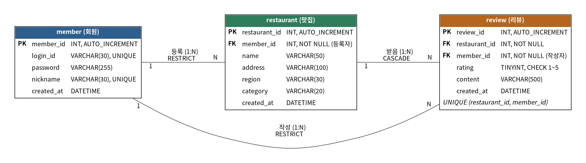

# 맛집로그 (MatLog)

식당 정보를 등록하고, 방문한 식당에 별점과 리뷰를 남기며, 식당별 평균 별점을 확인하는 Java 콘솔 프로그램입니다.
Java + MySQL(JDBC) + MVC 패턴으로 만들었습니다.

## 서비스 소개

- 맛집 정보와 후기가 여러 곳에 흩어져 있어 비교하기 어렵다는 문제에서 출발했습니다.
- 별점을 평균으로 집계해 가게 수준을 한눈에 볼 수 있게 했습니다.
- 가게당 한 회원은 리뷰를 1개만 쓸 수 있어, 한 사람이 평점을 부풀릴 수 없습니다.
- 가입과 로그인을 제외한 모든 기능은 로그인 후에만 쓸 수 있습니다.

## 기술 스택

| 구분 | 내용 |
|---|---|
| 언어 | Java 17 이상 |
| DB | MySQL 8.0 |
| 연결 | JDBC (MySQL Connector/J 9.1.0) |
| 빌드 | Gradle (Wrapper 포함) |
| 구조 | MVC (controller / service / dao / dto / view) |

## 실행 방법

**1. DB 만들기** — MySQL에서 아래를 순서대로 실행합니다.

```sql
CREATE DATABASE IF NOT EXISTS foodreview CHARACTER SET utf8mb4;
```

그다음 `sql/schema.sql`, `sql/sample-data.sql` 전체를 실행합니다.

**2. 접속 정보 설정** — `db.properties.example`을 프로젝트 루트에 `db.properties`로 복사하고 계정과 비밀번호를 채웁니다.
(`db.properties`는 `.gitignore`에 들어 있어 커밋되지 않습니다.)

```properties
db.url=jdbc:mysql://localhost:3306/foodreview?serverTimezone=Asia/Seoul&characterEncoding=UTF-8
db.user=계정
db.password=비밀번호
```

**3. 실행** — 아래 중 하나로 실행합니다. 작업 디렉터리는 프로젝트 루트여야 합니다.

```bash
./gradlew run
```

또는 IDE에서 `foodreview.Main`을 실행합니다.

## 샘플 계정

`sql/sample-data.sql`로 들어가는 테스트 계정입니다. 비밀번호는 입력한 값을 그대로 비교합니다.

| 아이디 | 비밀번호 | 닉네임 | 비고 |
|---|---|---|---|
| user01 | test_hash_01 | 먹보 | 1번 가게 등록, 2번 가게에 리뷰 작성 |
| user02 | test_hash_02 | 맛집탐험가 | 2번 가게 등록, 1번 가게에 리뷰 작성 |
| user03 | test_hash_03 | 밥심 | 3번 가게 등록, 1·2번 가게에 리뷰 작성 |
| user04 | test_hash_04 | 미식가 | 1·2번 가게에 리뷰 작성 |
| user05 | test_hash_05 | 테스터 | 가게·리뷰 없음 (빈 목록 확인용) |

3번 가게(불맛곱창)에는 리뷰가 없어서 "평점 없음" 화면을 확인하기 좋습니다.

## 실행 중 한글이 깨질 때

`./gradlew run`은 UTF-8 설정이 `build.gradle`에 들어 있습니다.
IDE에서 직접 실행하면 VM 옵션에 `-Dfile.encoding=UTF-8 -Dstdout.encoding=UTF-8`을 추가하세요.

## 기능 목록

| ID | 기능 | 설명 | 담당 |
|---|---|---|---|
| F-01 | 회원 가입 | 아이디·비밀번호·닉네임 입력 후 저장, 중복 검사 | 황하윤 |
| F-02 | 로그인 / 로그아웃 | 아이디·비밀번호 확인 후 로그인 상태 유지 | 황하윤 |
| F-03 | 내 정보 수정 / 탈퇴 | 닉네임 수정, 비밀번호 변경, 비밀번호 확인 후 탈퇴 | 황하윤 |
| F-04 | 맛집 등록 | 이름·주소·지역·카테고리 등록 | 이영주 |
| F-05 | 맛집 목록 조회 | 전체 맛집 목록 조회 | 이영주 |
| F-06 | 내 맛집 수정 / 삭제 | 본인이 등록한 가게만 수정·삭제 | 이영주 |
| F-07 | 리뷰 작성 | 별점(1~5)과 내용 작성, 가게당 1인 1리뷰 | 박유수 |
| F-08 | 맛집 상세 조회 | 가게 정보, 평균 별점, 리뷰 수, 최신 리뷰 10개 | 박유수 |
| F-09 | 내 리뷰 수정 / 삭제 | 내가 쓴 리뷰 목록에서 선택해 수정·삭제 | 박유수 |

## 선택 기능 구현 현황

| ID | 기능 | 구현 | 담당 |
|---|---|---|---|
| O-04 | 비밀번호 변경 | 완료 (내 정보 메뉴) | 황하윤 |
| O-08 | 카테고리 고정 목록 | 완료 (한식·중식·일식·양식·기타 번호 선택) | 이영주 |
| O-01 | 맛집 검색 (LIKE) | 미구현 | - |
| O-02 | 목록 페이징 | 미구현 | - |
| O-03 | 목록에 평균 별점 표시 | 미구현 (평균 별점은 상세 조회에서 확인) | - |
| O-05 | 비밀번호 해시 저장 | 미구현 | - |
| O-06 | 본인 가게 리뷰 금지 | 미구현 | - |
| O-07 | 맛집 중복 등록 방지 | 미구현 | - |

자세한 명세는 [docs/기획서.md](docs/기획서.md)를 참고하세요.

## 화면 예시

리뷰 기능(F-07~F-09)을 쓰는 모습입니다. `>` 뒤가 입력한 값입니다.

**맛집 상세 조회 (F-08) — 리뷰가 있는 가게**

```
가게 번호 > 1

===== 할매국밥 =====
카테고리: 한식
지역: -
주소: 경기도 성남시 수정구 예시로 1
평균 ★4.7 (리뷰 3개)

--- 리뷰 ---
[미식가] ★4 (2026-10-20)
  맛있지만 조금 짰어요.
[밥심] ★5 (2026-10-20)
  든든하게 먹기 좋아요.
[맛집탐험가] ★5 (2026-10-20)
  국물이 정말 맛있어요.
```

**맛집 상세 조회 (F-08) — 리뷰가 없는 가게**

```
가게 번호 > 3

===== 불맛곱창 =====
카테고리: 한식
지역: -
주소: 경기도 성남시 중원구 예시로 3
평점 없음

--- 리뷰 ---
작성된 리뷰가 없습니다
```

**리뷰 작성 (F-07)**

```
가게 번호 > 3
별점(1~5) > 5
리뷰 내용 > 처음 왔는데 국물이 진하고 좋아요
리뷰 등록 완료
```

같은 가게에 다시 쓰면 `이미 리뷰를 작성한 가게입니다`가 출력됩니다.

**내 리뷰 수정 / 삭제 (F-09)**

```
--- 내 리뷰 ---
[19] 불맛곱창 ★5 (2026-10-20)
    테스트 리뷰
[4] 스시하루 ★5 (2026-10-20)
    신선하고 맛있어요.
수정/삭제할 리뷰 번호 > 19
1. 수정  2. 삭제  0. 취소
선택 > 1
새 별점(1~5) > 4
새 리뷰 내용 > 맛이 조금 변했어요
수정 완료
```

## 콘솔 메뉴 구조

```
[로그인 전]
 1. 회원 가입
 2. 로그인
 0. 종료

[로그인 후]
 1. 맛집 관리
    1. 맛집 목록 조회
    2. 맛집 상세 조회
    3. 맛집 등록
    4. 내 맛집 수정 / 삭제
 2. 리뷰 관리
    1. 리뷰 작성
    2. 내 리뷰 수정 / 삭제
 3. 내 정보 수정 / 탈퇴
 4. 로그아웃
 0. 종료
```

## 프로젝트 구조

```
foodreview/
├── docs/                     기획서, ERD
├── sql/                      schema.sql, sample-data.sql
├── db.properties.example     접속 정보 양식
└── src/main/java/foodreview/
    ├── Main.java             프로그램 시작점
    ├── controller/           메뉴 흐름 제어 (View 와 Service 연결)
    ├── service/              업무 규칙 (검증, 중복 확인)
    ├── dao/                  SQL 실행, ResultSet → DTO 변환
    ├── dto/                  계층 사이 데이터 전달
    ├── view/                 콘솔 입력·출력
    └── util/                 DBUtil, ConsoleInput, LoginSession
```

### 계층별 규칙

| 계층 | 하는 일 | 하지 않는 일 |
|---|---|---|
| view | 입력받기, 결과 출력 | SQL 실행, 업무 판단 |
| controller | 메뉴 흐름 제어 | SQL 작성 |
| service | 업무 규칙(검증, 중복 검사) | 입출력 |
| dao | SQL 실행 | 사용자 입출력 |
| dto | 데이터 전달 | 로직 처리 |

## ERD



테이블은 `member`, `restaurant`, `review` 3개입니다.

- 회원 1:N 맛집, 회원 1:N 리뷰, 맛집 1:N 리뷰
- `review`는 (회원, 맛집) 쌍이 UNIQUE입니다. 가게당 1인 1리뷰를 DB에서도 보장합니다.
- 맛집을 삭제하면 그 가게의 리뷰도 함께 삭제됩니다. (`ON DELETE CASCADE`)
- 회원 행 자체는 `ON DELETE RESTRICT`라서, 리뷰나 맛집이 있는 회원은 DB에서 삭제되지 않습니다.
- 회원 탈퇴는 행을 지우지 않고 `member.withdrawn_at`에 탈퇴 시각을 기록합니다. 탈퇴한 회원은 로그인할 수 없고, 작성한 리뷰와 맛집은 그대로 남습니다.

## 아쉬운 점과 개선 계획

- **비밀번호 해시 저장(O-05)**: 지금은 비밀번호를 입력한 그대로 저장하고 비교합니다. 해시 변환을 공통 유틸 한 곳에 만들어 가입·로그인·비밀번호 변경·탈퇴 확인에 적용할 계획입니다.
- **맛집 검색·페이징(O-01, O-02)**: 맛집이 많아지면 전체 목록이 길어집니다. 이름·카테고리 LIKE 검색과 LIMIT/OFFSET 페이징을 추가할 계획입니다.
- **목록의 평균 별점(O-03)**: 평균 별점은 상세 조회에서만 볼 수 있습니다. 목록 SQL에 `LEFT JOIN review`와 `GROUP BY`를 더해 목록에서도 보이게 할 계획입니다.
- **본인 가게 리뷰 금지(O-06), 맛집 중복 등록 방지(O-07)**: 아직 막지 않아, 본인 가게에 리뷰를 쓰거나 같은 이름·주소의 가게를 등록할 수 있습니다.

## 브랜치 규칙

- `main` 발표용 완성본 / `develop` 통합본 / `feature/기능-이름` 개인 작업
- feature → develop PR, 1명 이상 리뷰 후 병합
- 기능 하나가 끝날 때마다 PR을 올립니다.

## 커밋 규칙

`feat|fix|docs|refactor|sql: 한글 설명`

## 팀원 / 담당

| 이름 | 역할 | 담당 테이블 | 담당 기능 |
|---|---|---|---|
| 황하윤 | A (팀장) | `member` | F-01 회원 가입, F-02 로그인/로그아웃, F-03 내 정보 수정/탈퇴 |
| 이영주 | B | `restaurant` | F-04 맛집 등록, F-05 맛집 목록, F-06 내 맛집 수정/삭제 |
| 박유수 | C | `review` | F-07 리뷰 작성, F-08 맛집 상세 조회, F-09 내 리뷰 수정/삭제 |
